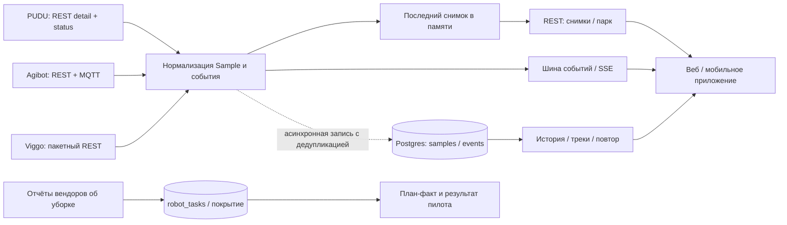

# Рабочая платформа AlfaRobot как опора для демо

Источник: `git@github.com:Exoldy/robots.git`, снимок
`dd4df1c992376ffaa34be06257a1e35ecd956d0c`. Локальная копия:
`C:/workspace/hackaton/robots-reference`. Репозиторий не изменялся;
сервер, облачные поллеры и команды роботам не запускались. Выводы подтверждены
исходниками, а не проверкой оборудования. Разбор выполняли отдельно специалисты
по телеметрии и визуализации; итог сопоставлен с текущим демо.

## Что здесь уже работает по коду

Это многовендорная система эксплуатации клининговых роботов: PUDU, Agibot,
Viggo. Сервер Express/TypeScript и Postgres, веб React/Vite/Ant Design,
мобильный Expo; общий пакет содержит контракт, геометрию и логику карты.
3D построен на том же Three.js r128, что и автономное демо.

SSE передаёт значения раньше подтверждения записи в БД. Поэтому увиденный
живой кадр не гарантирует наличие этого кадра в архиве. После разрыва потока
нужна сверка снимка/истории; устойчивого курсора replay в шине нет.

## Что фактически приходит

| Вендор | Канал в платформе | Данные и ограничения |
|---|---|---|
| PUDU | Пара REST-запросов по роботу, штатный такт около 10 с плюс время запроса; отдельные callback/ошибки | Положение, карта, заряд, состояние, текущая задача, прогресс, площадь, баки; часть полей имеет fallback/default. |
| Agibot | REST плюс MQTT `real_info`, `task_report`, `alarm` | MQTT приносит позицию и карту; REST — SOC/статус/баки. REST не приносит новую позу или текущую задачу. Отчёт о завершении — отдельный тип сообщения. Частота MQTT не гарантирована кодом. |
| Viggo | Общий REST-запрос на VIN парка, штатно около 10 с плюс запрос | Поза, карта, заряд, состояние, уровни воды; отдельно неисправности, расходники и отчёты. `velocity` доступна в API, но не сохраняется. Текущая задача и прогресс в общем Sample часто пустые/нулевые. |

Нормализованный Sample: время, SN, online, battery, run_state, charging,
position, map, task_id/name, percentage/area, баки и отдельные статусы Viggo.
**`position.z` — курс, не высота.** У Viggo он в градусах, карта переводит
его в радианы; сырые данные нельзя напрямую передавать в рендер.

Сырых потоков лидара, IMU, RSSI Wi-Fi, токов двигателей или видео в общем
контракте нет. Код аварии датчика не является значением этого датчика.
Управление поддержано в разных объёмах: в просмотренном коде PUDU/Viggo
имеют команды, Agibot — мониторинг/карты/историю; универсального управления нет.

## Что нельзя копировать без исправления смысла данных

1. **Один timestamp не доказывает свежесть всех полей.** Agibot REST копирует
   прежние pose/task под новым `Date.now()`. MQTT может перестать обновляться,
   а снимки REST продолжат выглядеть свежими. Нужны времена по полям и источник:
   `vendor / retained / derived / unavailable`, отдельно от времени получения.
2. **Пустота часто превращена в 0.** Это может означать «нет данных»,
   а не нулевой бак, скорость или процент. В новом адаптере нужны `null`
   и capabilities конкретной модели.
3. **Последняя задача не всегда текущая.** `getCurrentTasks()` выбирает
   последнюю начатую за 24 часа, включая завершённую. Fallback прогресса
   нельзя без времени/исхода показывать как текущий ход уборки.
4. **Разные виды достоверности позиции.** Карта различает `now / last / none`,
   устаревание и зависшие координаты. Состояние связи, статус работы,
   аппаратная ошибка и качество позы должны оставаться отдельными признаками.
5. **След не равен плановому маршруту.** В `motion.ts` есть sure/routed/unknown/gap.
   Достроенный по проходам отрезок — предположение. Кроме того, часть поведения
   внутри разрывов записи является визуальным достраиванием; это нельзя
   выдавать за измеренное движение или применять поверх точной физики демо.

Дополнительно: серверный SSE heartbeat — комментарий `: ping`, он не вызывает
браузерный `message`. Watchdog клиента его не видит. При нормальном потоке
замеры приходят часто, поэтому это условный дефект тихого канала, а не доказанный
постоянный обрыв связи. В рабочей платформе эти места пока не менялись.

## Полезные подходы визуализации

- Сцена живёт вне React и принимает готовые данные в метрах плана.
- Геометрия карты, растра и робота связана явными матрицами `worldToPlan` /
  `rasterToPlan`. Неверная карта или потерянная поза не должны скрываться
  декоративным перемещением робота на свободное место.
- `Kit` объединяет детали в mesh с цветами вершин; для обзора используются
  простые модели, для отдельного крупного плана — подробные PBR-модели.
- Маршруты — полосы из треугольников с шириной в метрах, читаемее WebGL-линии.
- Метки и кольца состояния помогают найти небольшую машину на крупном объекте,
  сохраняя метрический размер корпуса.
- Не переносим непрерывный рендер/DPR 2/все проходы постобработки по умолчанию:
  это вернуло бы уже исправленную нагрузку в покое.
- Модели уборщиков нельзя выдавать за Ronavi H1500. Размеры обзорной и
  подробной моделей в некоторых местах расходятся; нужен единый источник габаритов.

## Уже перенесено в экспериментальное демо

Разделены канонический момент наблюдения и время сглаженного кадра;
в интерфейсе и JSON явно указаны источник `simulation`, шаг 1 с,
метры плана и плановый характер маршрута. Сглаживание не генерирует новые
измерения и не меняет физику. Телеметрия включает задачи, заряд, пробег,
очереди и журнал, но не вымышленные датчики.

Перенесён принцип читаемых экранных меток без увеличения физического корпуса;
выбранная машина имеет выделение и более заметный оставшийся маршрут.
Парк остаётся инстансированным, рендер — по изменениям.

## Следующий продуктовый шаг

Для хакатона сильнее связка **«расчёт → план небольшого пилота → измеренный
план-факт»**. Уже существующая эксплуатационная платформа может подтвердить
результат пилота: выполненные уборки, простой, зарядку, ручные вмешательства,
площадь без повторного счёта. Это отдельная интеграция, она ещё не выполнена.

Минимальный следующий срез — обезличенная запись одного клинингового пилота,
его карта и адаптер replay. Режимы `simulation / replay / live` должны быть
явными. Достаточно чтения: команды, облачные ключи и продовые поллеры для
демонстрации не нужны. Экономика складского перемещения паллет при этом
не подменяет экономику уборки.

## Точные точки входа

Пути ниже относительно `robots-reference`:

- `dashboard/server/poller.ts:35`, `agibot-poller.ts:76`, `agibot-mqtt.ts:54`,
  `viggo-poller.ts:179` — вход и нормализация.
- `dashboard/server/store/samples.ts:99`, `stream-api.ts:76`,
  `store/robot-tasks.ts:84`, `routes/fleet.ts:20` — поток, архив и fallback задач.
- `packages/shared/src/types.ts:17`, `map-scene/types.ts:34`,
  `map-scene/presence.ts:13`, `map-scene/floor3d.ts:57` — контракт и качество карты.
- `dashboard/client/src/map/useMapData.ts:34`, `motion.ts:27`,
  `Stage3D.tsx:112`, `MapRobotCard.tsx:21` — отображение телеметрии.
- `dashboard/client/src/map/three/kit.ts:23`, `models.ts:97`,
  `robotDetail.ts:37`, `ribbons.ts:20`, `FloorScene.ts:236` — графика.

Полные независимые разборы:
`../research/alfa-audit/robots-reference-backend.json` и
`../research/alfa-audit/warehouse-3d/reference-3d-portable-review.json`.
